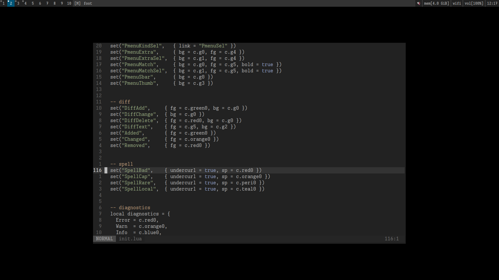
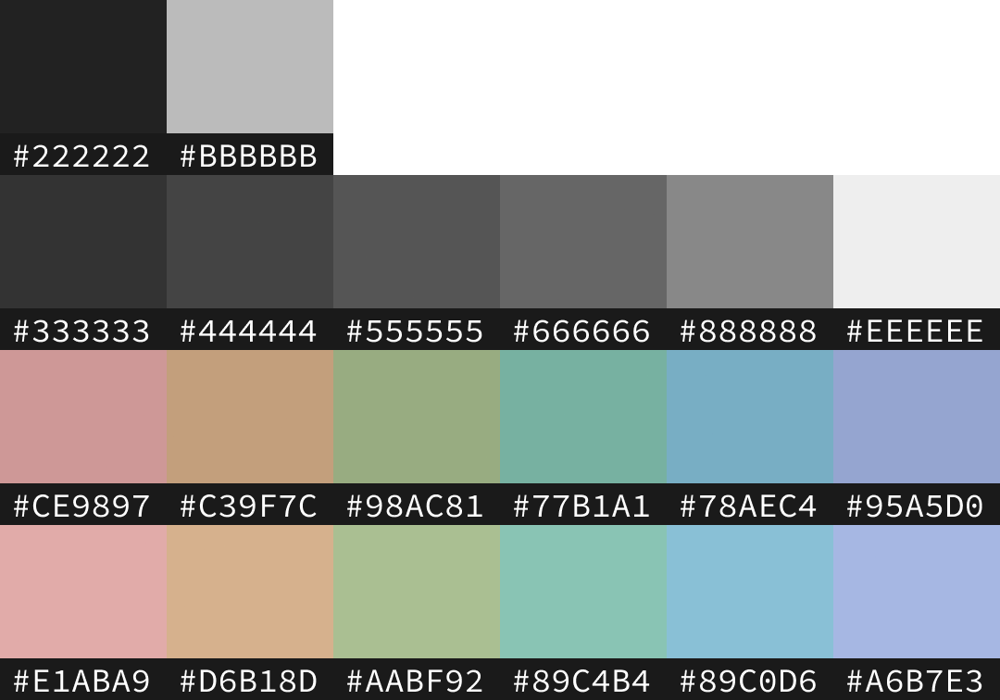

# silk

A low contrast colorscheme inspired by the dwm/dmenu default colors.





## Install

With `vim.pack`:
```lua
vim.pack.add({ "https://github.com/vanStinkle/silk.nvim" })
```

Apply the colorscheme with:
```lua
vim.cmd.colorscheme("silk")
```

## Configuration

Silk has zero setup / configuration API. If you want to override highlights, you can do so with an autocmd registered before the colorscheme loads.

```lua
vim.api.nvim_create_autocmd("Colorscheme", {
    pattern = "silk",
    callback = function()
        vim.api.nvim_set_hl(0, "Comment", { fg = "#888888" })
    end,
})

vim.cmd.colorscheme("silk")
```

For larger changes, you can either fork or clone the theme and then load your local copy with:
```lua
vim.opt.rtp:prepend(vim.fn.expand("path/to/your/copy"))
vim.cmd.colorscheme("silk")
```

Or, simply just make the necessary files in your `~/.config/nvim` directory and apply the theme as normal.
